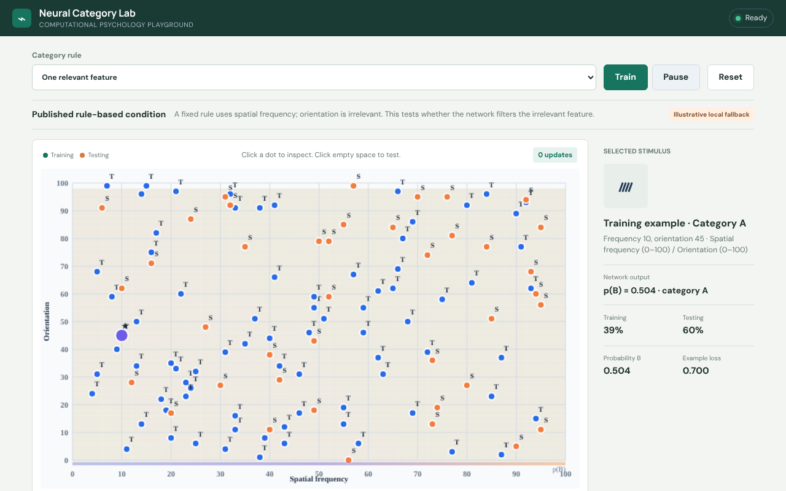

# Neural Category Lab

An interactive browser playground for **computational models of human category
learning**. A small neural network learns to sort visual stimuli – defined by
spatial frequency and orientation – into two categories, and every step of that
learning can be inspected live.



Built with plain JavaScript (ES modules + Canvas), no framework, no build step
and no runtime dependencies.

## Features

- **Three category structures:** a one-dimensional rule, a two-dimensional
  (diagonal) rule and a synthetic XOR task.
- **Configurable model:** hidden-layer size, learning rate and random seed –
  with zero hidden units the network becomes a linear classifier.
- **Training controls:** train continuously, pause, single-step, reset or replay
  the same seed for fully reproducible runs.
- **Inspect everything:** click a stimulus to see its prediction, click empty
  space to probe the decision surface, select a hidden neuron to view its bias
  and activation, or temporarily "lesion" it.
- **Learning curves:** training vs. test loss and accuracy (evaluation never
  updates the weights).

## Model

| | |
|---|---|
| Inputs | 2 features, normalised from a 0–100 display scale |
| Hidden layer | tanh units |
| Output | sigmoid, binary cross-entropy loss |
| Optimiser | full-batch gradient descent |
| RNG | seeded `mulberry32` for deterministic datasets and initialisation |

## Run locally

```bash
npm run serve      # python -m http.server 4173
```

Then open <http://localhost:4173>. Any static file server works.

## Tests

```bash
npm test           # node --test, no dependencies needed
```

The test suite checks numerical correctness, that the network actually learns,
reproducibility across seeds and that evaluation does not change the model.

## Project structure

```
├── index.html          interface and controls
├── styles.css          responsive layout and styling
├── app.js              application state, interaction, canvas visualisations
├── model.js            datasets and neural-network implementation
└── tests/
    └── model.test.js   unit tests (node:test)
```

## Data note

The stimuli are generated locally from documented category rules. They are
illustrative and do not contain or reproduce real participant data. The XOR
task is a synthetic teaching extension.
